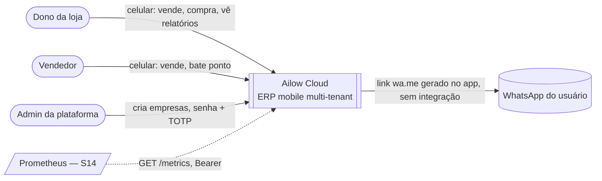
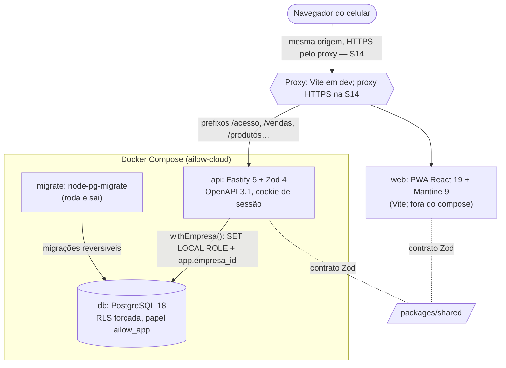
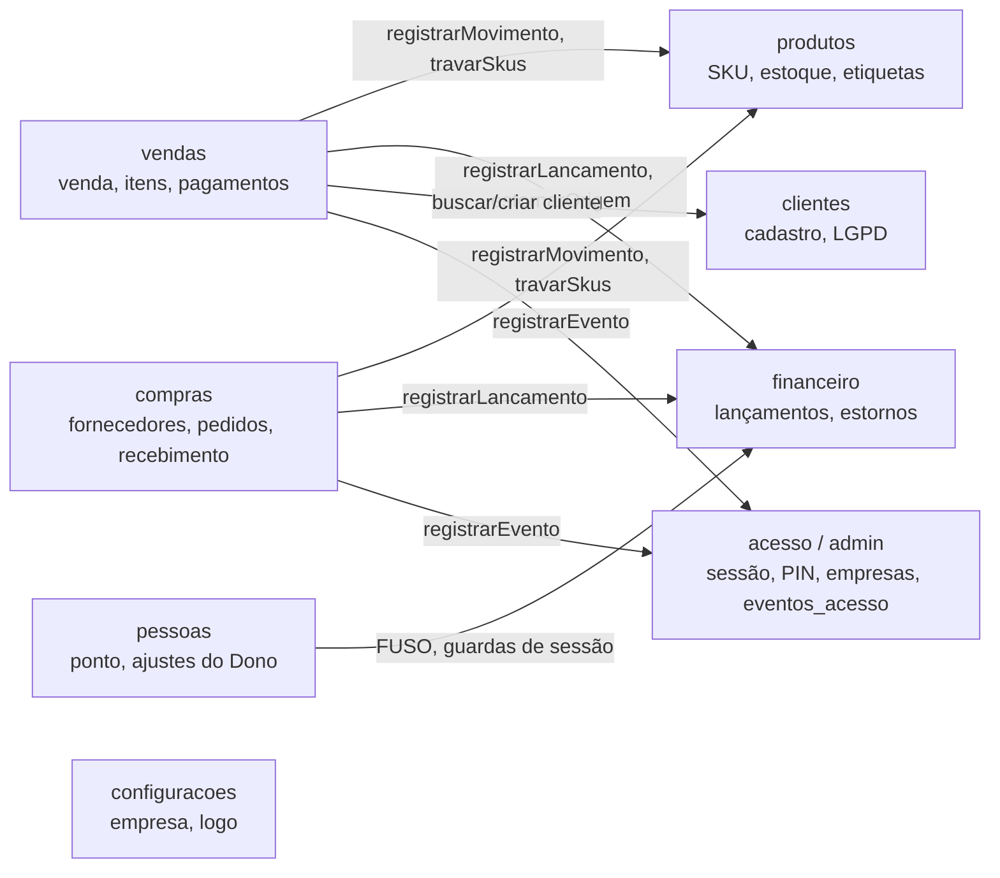

# Arquitetura — C4 (contexto e contêineres) e mapa de contextos

*Rev. 2026-11-12 (S13c). Fonte: código na `main`, `compose.yaml`, ADR 001/002/004/005. Em Mermaid para versionar com o código. O que ainda não existe (proxy HTTPS, Prometheus, VPS) está marcado "S14".*

## Nível 1 — Contexto

Não há integração de servidor com terceiros no MVP: o WhatsApp é só um link aberto no aparelho (`POST /compras/{id}/enviar`). O inventário de interfaces é `docs/auditoria/inventario-interfaces.md`.

## Nível 2 — Contêineres

- **Mesma origem:** o navegador só fala com uma origem; o proxy encaminha por prefixo de rota (lista em `apps/web/vite.config.ts`). Por isso o cookie `SameSite=Strict` funciona sem CORS. Hospedagem do web em produção: S14 (não definida ainda).
- **Isolamento:** toda requisição de negócio abre uma transação em `withEmpresa()`; o Postgres só enxerga as linhas da empresa da sessão (ADR 002). Pool de conexões da API: `DB_POOL_MAX` (padrão 10).
- **Contrato:** `packages/shared` (Zod) é a fonte; a API gera `docs/openapi.json`, validado por Spectral e Schemathesis (S13a).
- **Observabilidade:** logs JSON com `request_id` no stdout; `GET /metrics` (RED por rota) só com `METRICS_TOKEN`.
- **Implantação:** local por `docker compose up`; VPS, proxy e Prometheus são a S14.

## Mapa de contextos (módulos da API)

Cada pasta de `apps/api/src/` é um contexto. Um módulo só grava nas **próprias** tabelas; os outros entram pela interface pública do dono do dado, na mesma transação (ADR 005).

| Contexto | Dono de | Relação |
|---|---|---|
| acesso / admin | usuários, sessões, aparelhos, empresas, trilha de acesso | fornecedor de `registrarEvento` e `exigirPerfil` para todos |
| produtos | SKU, saldo e movimentos de estoque (só-acréscimo) | fornecedor de `registrarMovimento` para vendas e compras |
| financeiro | lançamentos e estornos | fornecedor de `registrarLancamento`/`estornarOrigem` (ADR 005) |
| clientes | cadastro e anonimização (ADR 007) | fornecedor de busca/criação para vendas |
| vendas | venda, itens, pagamentos, numeração (ADR 009) | cliente de produtos, financeiro e clientes |
| compras | fornecedores, pedidos, recebimento | cliente de produtos e financeiro |
| pessoas | ponto e ajustes (ADR 008) | quase independente; usa só o fuso (`FUSO`) do financeiro e as guardas de sessão do acesso |

Texto "Venda N": a venda grava só "Venda" em movimentos e lançamentos; o número é composto na leitura pelo `origem_id` (ADR 009).
