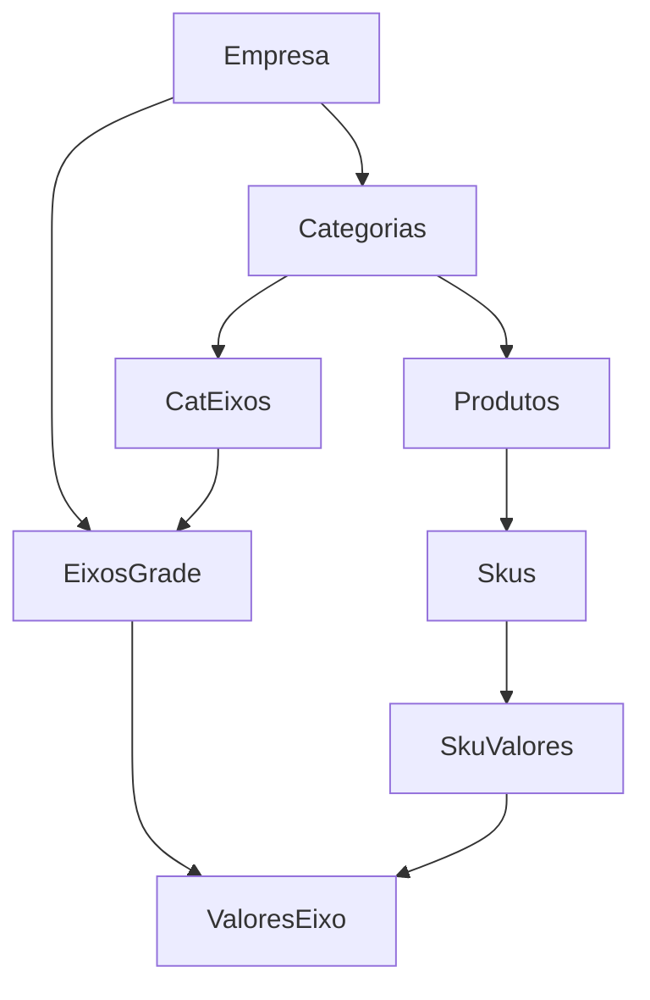

# Design: eixos de grade configuráveis + seed estrutura Marcant

> **Status:** aprovado para plano de implementação (decisões da sessão 2026-11-17).  
> **App:** ailow-cloud · **Tier:** B  
> **Gate:** feature + migração + UI · regras `ARQ-*`, `TEST-*`, ADR 002/006/017, `UXM-*`, `AUD-*` (seed em conta real = só estrutura, sem inventar preços/estoque).  
> **Relacionados:** [ADR 017](../../adr/017-tamanhos-e-cores-configuraveis.md), [ADR 006](../../adr/006-produtos-sku-estoque.md), [P1](../../pesquisa/P1-modelagem-produto.md).

## 1. Problema

A grade hoje é fixa em dois tipos (`tamanho` | `cor`) em `opcoes_grade` (ADR 017). A Marcant (e outras lojas) precisam de eixos adicionais que **multipliquem SKU** (ex.: taça), definidos uma vez na empresa e ligados por categoria — sem promover atributos de ficha (bojo, aro) a produto/SKU.

O pacote `marcant_seed_homologacao` é **fictício** e **não** entra em produção. Nesta entrega: só estrutura (categorias + eixos + valores).

## 2. Decisões fechadas

| Tema | Decisão |
|------|--------|
| Conta | Marcant real (cloud) |
| Modelo | Generalizar ADR 017 (abordagem 1) |
| Efeito do eixo | Multiplica SKU (estoque + QR) |
| Onde define | Biblioteca da **empresa** → ativação por **categoria** → produtos herdam |
| Seed agora | Só estrutura; zero produtos/preços/estoque inventados |
| Ficha | bojo/aro/compressão/alça continuam liga/desliga em `categorias.atributos` |

## 3. Modelo de dados

### 3.1 Entidades novas

| Tabela | Campos essenciais | Regras |
|--------|-------------------|--------|
| `eixos_grade` | `id`, `empresa_id`, `nome`, `slug`, `tipo_valor` (`tamanho`\|`cor`\|`texto`), `sistema` (bool), `seq`, `ativo`, `criado_em` | RLS + `isolamento_empresa`. Slugs `tamanho` e `cor` são **sistema**: não renomear slug, não apagar. Sem DELETE físico. |
| `valores_eixo` | `id`, `empresa_id`, `eixo_id`, `nome`, `amostra` (só cor), `ativa`, `seq` | Mesmas regras de texto do SKU atual para `tamanho`/`cor`; `texto` curto 1–3 alfanum (ex.: A, B, 44B se couber na regra de código). Sem DELETE — desativar. |
| `categoria_eixos` | `empresa_id`, `categoria_id`, `eixo_id`, `seq` | PK `(categoria_id, eixo_id)`. Só categorias `tipo='produto'`. Máx. **4** eixos por categoria. Ordem = ordem do wizard. |
| `sku_valores` | `empresa_id`, `sku_id`, `eixo_id`, `valor_id` | Um valor por eixo ativo da categoria do produto. Unicidade da combinação de valores por produto (além de tamanho×cor denormalizado). |

### 3.2 Compatibilidade com SKUs atuais

- Colunas `skus.tamanho`, `skus.cor`, `skus.cor_codigo`, `skus.codigo` **permanecem**.
- No create: valores dos eixos sistema preenchem essas colunas; eixos extras só em `sku_valores`.
- Código QR: base **`PPPP-TT-CCC`**. Se houver eixos extras, sufixo `-` + código curto de cada eixo extra na ordem de `categoria_eixos.seq` (ex.: `0042-46-CHO-A`). Limite total do código: documentar no ADR (caber no QR alfanumérico da etiqueta).
- `GET` de produto continua expondo `tamanho`/`cor` nos SKUs; resposta ganha `eixos: { slug, nome, valor }[]` por SKU (ou equivalente estável no contrato shared).

### 3.3 Limites

- ≤ **4** eixos ativos por categoria.
- ≤ **144** SKUs por produto (`MAX_SKUS_POR_PRODUTO`).
- ≤ **12** cores por produto (limite atual).
- Grade imutável após criar o produto (igual ADR 006): eixos/valores do SKU não mudam na edição do modelo.

### 3.4 Migração (expand → migrate → contract)

1. **Expand:** criar tabelas novas; backfill eixos sistema + valores a partir de `opcoes_grade` por empresa; ligar categorias existentes a Tamanho+Cor; popular `sku_valores` a partir de `skus.tamanho`/`cor`.
2. **Migrate (app):** API/UI passam a ler/escrever eixos; endpoints `/opcoes-grade` viram fachada ou são substituídos por `/eixos-grade` (versão OpenAPI bump).
3. **Contract (ciclo seguinte):** deprecar/remover `opcoes_grade` quando zero leitores.

Seed-on-first-read dos eixos sistema (como ADR 017), não na migração global sem `empresa_id` de sessão.

## 4. UX / frontend

**Design System:** PWA balcão lingerie — flat + denso (toque ≥48px, Mantine 9 existente).  
**Não inventar** tema novo; estender Config e assistentes atuais.  
**Evitar:** card spam, eixos misturados com atributos de ficha na mesma lista sem rótulo, wizard com N eixos na mesma tela.

### 4.1 Configurações (Dono)

Nova área no menu Config (ou evolução da engrenagem do Novo produto):

1. **Eixos da grade** (biblioteca da empresa)
   - Lista eixos: Tamanho, Cor (sistema, cadeado), + custom (ex. Taça).
   - Criar eixo: nome + tipo de valor (`texto` / reutilizar padrões).
   - Entrar no eixo → lista de valores (chips), criar, renomear, desativar, amostra se cor.
2. **Categorias** (tela atual)
   - Além de atributos de ficha: seção **“Eixos desta categoria”** com switches dos eixos da biblioteca + reordenar (seq).
   - Default ao criar categoria produto: Tamanho + Cor ligados.
   - Copy: “Eixos geram variações com estoque e QR. Atributos (bojo, aro…) só descrevem a peça.”

Estados: loading skeleton da lista; empty “Nenhum eixo custom — Tamanho e Cor já vêm prontos”; erro + retry.

### 4.2 Novo produto

Passos dinâmicos derivados de `categoria_eixos` (ordem `seq`):

`categoria → modelo/porte → atributos (ficha) → [para cada eixo: escolher valores] → conferir grade (matriz N eixos) → custo → preço → estoque`

- Tamanho e Cor mantêm UI atual (`PassosGrade`) quando presentes.
- Eixo extra: mesma metáfora de chips marca/desmarca.
- Grade final: tabela/lista das combinações cartesianas com estoque/mínimo; aviso se >144.
- Microcopy botões: “Salvar produto”, “Adicionar valor”, não “OK/Submit”.

### 4.3 Venda (Wizard catálogo)

Passos: categoria → produto → **um passo por eixo ativo** (tamanho, cor, …) → confirma.

- Só SKUs com estoque > 0.
- Detalhe no carrinho: valores unidos com ` · ` na ordem dos eixos (ex.: `46 · Chocolate · A`).

### 4.4 Exibição padronizada do produto

| Contexto | Formato |
|----------|--------|
| Lista / busca | `nome` + porte; subtítulo categoria |
| SKU / etiqueta / QR | código `PPPP-TT-CCC[-X…]` |
| Linha do carrinho | `nome` · `valor1 · valor2 · …` |
| Ficha | chips dos atributos liga/desliga (não confundir com eixos) |

## 5. Seed estrutura Marcant (produção)

**Escopo:** categorias de produto + eixos + valores + ligações. **Proibido:** produtos, SKUs, preços, estoque, fornecedores inventados do JSON de homologação.

### 5.1 Categorias (ativas) + atributos de ficha

| Categoria | Atributos (liga/desliga) | Eixos ativos (ordem) |
|-----------|--------------------------|----------------------|
| Calcinha | renda, compressão | Tamanho, Cor |
| Sutiã | bojo, aro, compressão, alça removível, renda | Tamanho, Cor *(Taça na biblioteca, **desligada** até Marcos pedir)* |
| Modelador | compressão | Tamanho, Cor |
| Cinta | compressão | Tamanho, Cor |
| Body | — | Tamanho, Cor |
| Robe | — | Tamanho, Cor |
| Baby doll | — | Tamanho, Cor |
| Conjunto | — | Tamanho, Cor |
| Acessório | — | Tamanho (U), Cor |

Não criar categorias “Não classificado”, “Linha sensual” ou “Meia-calça” até validação do Marcos.

### 5.2 Eixos e valores (biblioteca)

| Eixo | Sistema | Valores iniciais |
|------|---------|------------------|
| Tamanho | sim | P, M, G, GG, U, 40, 42, 44, 46, 48, 50, 52, 54, 56 (iguais `TAMANHOS_PADRAO`) |
| Cor | sim | Preto, Nude, Branco, Vermelho, Chocolate, Vinho, Rosa, Azul (`CORES_PADRAO` + amostras) |
| Taça | não | A, B, C, D — **criada na biblioteca, não ligada a nenhuma categoria** no seed |

### 5.3 Como aplicar

- Script/runbook **idempotente** por `empresa_id` Marcant (Admin cria empresa se ainda não existir; humano confirma o UUID).
- Preferir API autenticada como Dono (ou `withEmpresa` em script de ops) — não SQL solto sem evidência.
- Evidência: log do script + checklist AUD (mudança em produção só com pedido explícito + PR/aprovação humana).
- **Não** carregar `marcant_*_teste` / preços 29/59/89 fictícios.

## 6. Critérios de aceite mensuráveis

1. Empresa nova (ou Marcant pós-seed) tem eixos sistema Tamanho e Cor com os valores padrão; `GET` lista eixos + valores.
2. Dono cria eixo “Taça” com A–D; liga só em Sutiã; Novo produto de Sutiã exige escolher taça; Calcinha não mostra passo Taça.
3. Produto Sutiã com 2 tamanhos × 2 cores × 2 taças cria **8** SKUs; códigos distintos; estoque independente.
4. Produto legado (só tamanho×cor) continua listável/vendável sem regressão nos testes atuais de produtos/vendas.
5. Seed Marcant: ≥9 categorias da tabela §5.1; 0 produtos criados pelo seed; Taça existe e está desligada das categorias.
6. `npm run verify` verde; testes de isolamento 2 empresas nos novos endpoints; E2E mínimo: criar eixo, ligar em categoria, cadastrar produto com 3º eixo.

## 7. Fora de escopo (agora)

- Preço atacado por SKU/canal.
- Editar grade após criar produto.
- Taça ligada em Sutiã no seed (fica na biblioteca só).
- Importador do Excel/JSON de homologação.
- Remover tabela `opcoes_grade` (contract em ciclo posterior).
- Carga das 20 peças carro-chefe (exige planilha real do Marcos).

## 8. Alternativas descartadas

- **EAV puro no SKU:** flexível demais; quebra QR/etiqueta/contratos.
- **Só +1 eixo custom hardcoded:** barato, mas não atende “criar mais variáveis”.
- **Eixos só por produto:** cadastro longo; rejeitado em favor de biblioteca + categoria.
- **Seed com SKUs fictícios em produção:** proibido pelo aviso do pacote e por AUD.

## 9. Próximo artefato

Plano de implementação TDD em `docs/superpowers/plans/2026-11-17-eixos-grade-marcant.md`.
